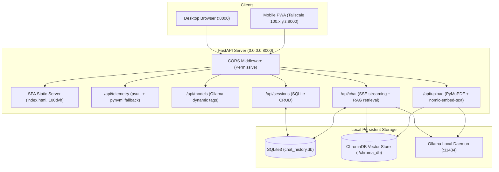

# Local AI Studio: Mobile-First Full-Stack Dashboard

An ultra-responsive, privacy-first **Local AI Dashboard** powered by FastAPI, Ollama, ChromaDB, SQLite, and real-time hardware telemetry. Engineered from the ground up for desktop and mobile devices over local Wi-Fi and **Tailscale mesh VPN**.

---

## Architecture Overview



---

## Key Features

1. **Mobile-First Dynamic UI (`100dvh`)**:
   - Uses dynamic viewport units (`100dvh`) so on-screen mobile software keyboards on iOS Safari and Android Chrome never break the viewport layout.
   - PWA meta tags (`apple-mobile-web-app-capable`, `black-translucent` status bar) for standalone app installation.
   - iOS/Android Home Indicator safe-area inset padding (`env(safe-area-inset-bottom)`).
   - Sliding mobile navigation drawer with touch-friendly tap targets (&ge; 44px).

2. **Persistent Multi-Session Chat (`chat_history.db`)**:
   - Embedded SQLite database storing sessions and complete message histories.
   - Conversations persist seamlessly across page reloads and device switches.
   - Ability to create new chats, switch between historical threads, and delete sessions.

3. **Dynamic Model Switching**:
   - Fetches available local models dynamically from Ollama (`http://localhost:11434/api/tags`).
   - Quick one-tap switches between `llama3.1:8b` and `qwen2.5-coder:7b`.

4. **Document Ingestion & RAG (Retrieval-Augmented Generation)**:
   - Drag-and-drop or file upload for `.txt` and `.pdf` files (powered by `PyMuPDF`).
   - Text chunking and semantic embeddings generated via `nomic-embed-text`.
   - Vector persistence in ChromaDB with cosine similarity search and collapsible citation drawers.

5. **Real-Time Hardware Telemetry**:
   - Pinned top banner polling every 2 seconds displaying CPU %, RAM (used/total), GPU Utilization %, GPU VRAM, and GPU Temperature.
   - Robust `pynvml` exception handling with graceful simulated fallback if an NVIDIA GPU is not detected.

---

## Prerequisites

- **Python**: 3.10, 3.11, 3.12, or 3.13
- **NVIDIA GPU & Drivers** (Optional, for GPU acceleration; falls back gracefully to mock metrics)
- **Ollama**: Installed and running locally on port 11434

---

## 1. Pull Required Ollama Models

Open your terminal and run:

```bash
# Pull general-purpose conversational LLM
ollama pull llama3.1:8b

# Pull code generation & reasoning LLM
ollama pull qwen2.5-coder:7b

# Pull high-performance embedding model for RAG
ollama pull nomic-embed-text
```

---

## 2. Installation & Setup

1. **Clone or navigate to the repository**:
   ```bash
   cd "Local AI"
   ```

2. **Create and activate a virtual environment**:
   - **Windows (PowerShell)**:
     ```powershell
     python -m venv venv
     .\venv\Scripts\Activate.ps1
     ```
   - **Linux / macOS**:
     ```bash
     python3 -m venv venv
     source venv/bin/activate
     ```

3. **Install dependencies**:
   ```bash
   pip install fastapi uvicorn ollama chromadb pynvml psutil pymupdf python-multipart
   ```

4. **Start the FastAPI Server**:
   ```bash
   uvicorn main:app --host 0.0.0.0 --port 8000
   ```
   *Binding to `0.0.0.0` ensures the server is reachable locally and across your Wi-Fi/Tailscale networks.*

---

## 3. Tailscale Mobile Access Guide (Remote Mesh VPN)

Access your Local AI Dashboard from your iPhone, Android, or laptop anywhere in the world with zero port-forwarding or public IP exposure:

### Step 1: Install Tailscale on your Host PC
1. Download and install Tailscale from [tailscale.com](https://tailscale.com/download).
2. Log in and verify your PC is connected to your Tailscale tailnet.
3. Find your PC's Tailscale IPv4 address:
   - In PowerShell/CMD:
     ```powershell
     tailscale ip -4
     ```
   - Or open the Tailscale tray icon. It will look like: `100.x.y.z` (e.g., `100.85.120.45`).

### Step 2: Install Tailscale on your Mobile Phone
1. Install **Tailscale** from the Apple App Store or Google Play Store.
2. Sign in with the exact same account you used on your PC.
3. Toggle the VPN switch **ON** in the Tailscale app.

### Step 3: Access the Dashboard from Mobile
1. Open Safari (iOS) or Chrome (Android).
2. Navigate to:
   ```text
   http://100.x.y.z:8000
   ```
   *(Replace `100.x.y.z` with your PC's Tailscale IP).*

### Step 4: Install as a Native Mobile App (PWA)
- **On iOS (Safari)**:
  1. Tap the **Share** button (box with upward arrow) at the bottom.
  2. Scroll down and tap **"Add to Home Screen"**.
  3. Tap **Add**. An app icon will appear on your iOS home screen that launches full-screen without browser address bars!
- **On Android (Chrome)**:
  1. Tap the **three dots menu** at the top right.
  2. Tap **"Install App"** or **"Add to Home screen"**.
  3. Confirm installation. The PWA will run in its own dedicated window.

---

## 4. API Endpoints Reference

| Method | Endpoint | Description |
| :--- | :--- | :--- |
| `GET` | `/` | Serves single-page mobile-first application |
| `GET` | `/api/telemetry` | Real-time CPU, RAM, GPU utilization, VRAM, and temperature |
| `GET` | `/api/models` | List of models detected from Ollama daemon |
| `GET` | `/api/sessions` | List all saved chat sessions stored in SQLite |
| `POST` | `/api/sessions` | Create a new chat session (`{ title, model }`) |
| `GET` | `/api/sessions/{id}` | Retrieve session message history and sources |
| `PATCH`| `/api/sessions/{id}` | Rename/update session title |
| `DELETE`| `/api/sessions/{id}`| Delete chat session and associated messages |
| `POST` | `/api/upload` | Ingest `.txt` and `.pdf` files, chunk, embed, and store in ChromaDB |
| `GET` | `/api/documents` | List all ingested documents and chunk counts |
| `DELETE`| `/api/documents` | Clear all ingested documents from ChromaDB |
| `POST` | `/api/chat` | SSE streaming inference with RAG context and SQLite persistence |

---

## License

MIT License. Free for personal and commercial local AI deployments.
